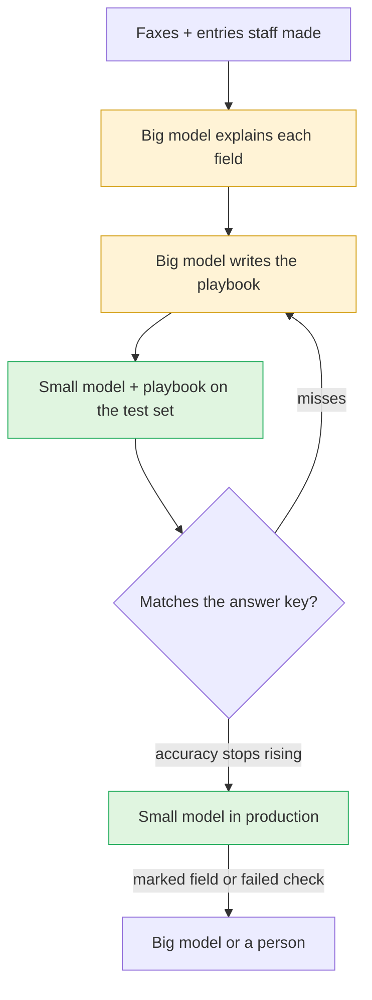
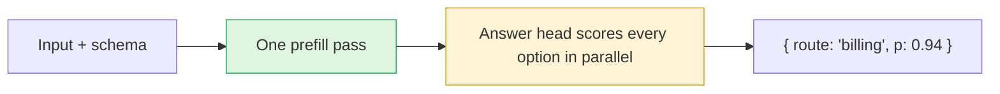
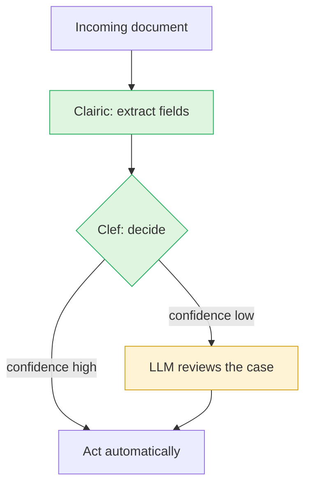

[Part one](/blog/llms-production/) cut an agent's bill by 85% with prompt caching, which made reused input up to 98% cheaper. Caching doesn't change what the model itself charges per token.

This post moves steps to cheaper models. For a fixed workflow, a big model can write a prompt that lets a model 40 times cheaper do the same job. For steps that only pick a label or pull out a value, a small model that only reads, called a System One model, can replace the LLM.

## Let a big model write the prompt for a small one

Claude Haiku 5.5 charges $0.10 per million input tokens and $0.50 per million output, 40 times less than Opus 5.5 on both ([pricing](https://platform.claude.com/docs/en/about-claude/pricing)).

A small model is cheaper because it has fewer weights to run for each token. The trade-off is that it knows less and reasons less, so on an open-ended task it makes more mistakes. On a fixed workflow, every request follows the same steps, so most of the reasoning is the same every time. A big model can work it out once and write it down, and the small model follows the written steps on every request.

This is distillation. The usual version fine-tunes a small model, meaning it trains it further on the big model's answers. [Distilling Step-by-Step](https://arxiv.org/abs/2305.02301) (ACL 2023) trained a model 700 times smaller than Google's PaLM on the reasons PaLM gave for its answers. On one benchmark, the small model scored higher than PaLM did with a few examples in its prompt. The cheaper version skips training and puts the reasoning in the prompt.

### Example: prescription extraction

Many pharmacies still receive prescriptions by fax. Someone reads each one and types it into the pharmacy system. The steps never change. Find the patient, the prescriber, the drug, the strength, the quantity, the directions and the refills. Expand the shorthand in the directions, so "1 tab po bid x 10d" becomes "take 1 tablet by mouth twice a day for 10 days". Match the patient and the drug to existing records. Flag anything the pharmacist should look at closely.

Clairic, covered below, could pull most of these fields. Expanding the directions means writing new text, and that needs a model that writes. The matching needs your records, so give the model a search tool for patients and drugs, or do the matching in code after it reads the names.

A big model does this well because it reasons through each fax. Here is how to move that reasoning into a prompt for a small model.

1. Collect a few hundred real faxes with the entries your staff made for them. These are your answer key. Split them three ways: one set to write the playbook, one to test it while you improve it, and one you don't touch until the end.
2. Give the big model each fax from the first set together with the staff's entry. Run it at high effort, the setting that controls how long it thinks, and ask it to explain how to get from the fax to each field. Have it flag any field where it disagrees with the staff.
3. Ask the big model to turn those explanations into a playbook. It should have a rule for each field, a table of the abbreviations it met, the hard cases and how to resolve them, and a few worked examples. Tell the playbook to have the small model mark any field it can't read or resolve.
4. Run the small model with the playbook on the test set and compare field by field. Drug, strength, quantity and refills must match exactly. For the directions, have the big model judge whether the meaning matches.
5. Give the misses back to the big model and ask it to fix the playbook. Repeat until accuracy on the test set stops going up. Then check it once on the untouched set.
6. Ship the small model. Send faxes with a marked field, and any that fail a check in your code such as an unknown drug or a quantity out of range, to the big model or to a person.

You don't have to run this loop by hand. [DSPy](https://arxiv.org/abs/2310.03714), from Stanford, rewrites prompts to score better on a metric you choose, such as the share of fields that match the answer key. OpenAI's cookbook has a related recipe, [using reasoning for routine generation](https://developers.openai.com/cookbook/examples/o1/using_reasoning_for_routine_generation), where o1 writes step-by-step routines for another model to follow.

### What it does to the bill

Assume a fax page is about 3,000 input tokens with the image, and the entry is about 600 output tokens. On Opus 5.5 at high effort the model thinks for about 4,000 tokens, which you pay for as output. On Haiku 5.5 at low effort it thinks for about 300, with a 10,000-token playbook in the cache.

|                           | Per fax  | 5,000 faxes a day, for 30 days |
| ------------------------- | -------- | ------------------------------ |
| Opus 5.5                  | $0.108   | $16,200                        |
| Haiku 5.5 with a playbook | $0.00085 | $128                           |

That is about 127 times less, if no fax goes back to Opus. Each one that does costs the full $0.108 on top, so the share you send back decides the saving. At 10% the blend is about $0.012 a fax, 9 times less than Opus alone. At 2% it is about 36 times less. One round of building the playbook over 300 faxes on Opus costs about $32. Your token counts will differ, so measure your own and run the numbers again.

Put the playbook at the start of the prompt, before the fax, so every request after the first reads it from the [cache](/blog/llms-production/#prompt-caching-means-skipping-prefill) at $0.01 per million tokens. Keep the whole prompt under 100,000 tokens, because above that Haiku 5.5 charges five times more for every token in the request.

### Why a prompt and not fine-tuning

Fine-tuning is the other route, and it is getting harder. OpenAI's [fine-tuning guide](https://developers.openai.com/api/docs/guides/supervised-fine-tuning) now says "OpenAI is winding down the fine-tuning platform." New users can't start, and existing customers can create training jobs until 6 January 2027.

A playbook doesn't depend on a training platform. You can read it, review changes to it in a pull request, and move it to another provider's small model after you rerun the answer key. When the workflow changes, you edit the prompt instead of fine-tuning again. Fine-tuning an open-weight model, one whose weights you can download and train yourself, is still an option when a prompt isn't enough.

Keep the answer key after you ship. Run it every time the playbook or the model changes, the same way you run tests.

Faxes carry patient health information. Check that every provider in the loop, including the one running the big model, has the agreements your health privacy law requires and doesn't keep or train on the data. Strip names, dates of birth and health card numbers from the worked examples, because the playbook goes out with every request and lives in your repo.

## System One and System Two models

Some steps don't need an LLM at all.

Many agent steps don't write anything a person reads. They pick a route for a ticket. They decide whether a document is an invoice. They check whether a task is done. They pull a total and a due date out of a PDF. An LLM answers each of these by running decode, sometimes writing hundreds of tokens of hidden reasoning first, which you pay for as output, to write a few words that your code then parses.

TypeSafe AI borrowed Daniel Kahneman's terms for this split ([announcement](https://typesafe.ai/blog/introducing-system-one-models-and-jev)). System Two is "slow, deliberate" reasoning. That is the work LLMs are for: chat, coding agents, proofs. System One is "fast, intuitive" thinking. A System One model takes unstructured input and returns a typed answer and how sure it is. It never writes a sentence.

These models skip decode, the slow phase that writes the answer one token at a time ([part one](/blog/llms-production/#how-a-model-answers-prefill-and-decode) explains both phases). Cloudflare describes its System One decision model as running "a prefill-only pass, then scores the valid schema choices in parallel" ([Clef announcement](https://blog.cloudflare.com/clef-decision-models/)). The model reads the input once, the same as an LLM's prefill. A small extra layer on top then scores each option you supplied. Nothing is written token by token, so the slow phase never runs.

Per token, reading is much cheaper than writing, and these models only read.

### The models you can use today

**Jev**, from TypeSafe AI, was released in early access on 15 September 2026 ([announcement](https://typesafe.ai/blog/introducing-system-one-models-and-jev)). TypeSafe says Jev returns all its probabilities at once instead of writing token by token, but it has not published the architecture. It charges $0.042 per million input tokens, and output is "FREE (too cheap to meter)." TypeSafe reports responses in 70 to 500 ms and calls itself "193.6x faster, 444.6x cheaper" on its own workflow evals. It also says it can't rule out that the price is subsidized.

**Clef** is Cloudflare's decision model, released on 1 October 2026 ([announcement](https://blog.cloudflare.com/clef-decision-models/), [changelog](https://developers.cloudflare.com/changelog/post/2026-10-01-clef-workers-ai/)). It comes in two sizes on Workers AI. `@cf/cloudflare/clef` is a 27B model, slower and more accurate. `@cf/cloudflare/clef-flash` is a 9B model for high-volume steps where speed matters more. Both have a 64K context window and take images. The weights are open under Apache 2.0, and the API is compatible with Jev's. Cloudflare reports median latency of 38.8 ms for Clef-flash, 209.3 ms for Clef and 524.1 ms for Jev. Use Clef when the answer is one of a set of options you can list: a route, a label, yes or no, a score.

**Clairic** is Cloudflare's extraction model, previewed on 19 October 2026 ([announcement](https://blog.cloudflare.com/clairic-extraction-model/), [model page](https://developers.cloudflare.com/workers-ai/models/clairic/)). A decision model picks from options you give it. Clairic returns values from the input instead: a date, a number, a span of text, a list, or an estimate with a range. You send text, up to four images, and a set of typed fields. You get back each field with a confidence score, or `null` when the input doesn't contain it. It "only processes input tokens with a single forward pass," costs $0.10 per million input tokens, and charges nothing for output.

Cloudflare tested both models together on a claims-processing pipeline. Clairic pulled the values in 0.46 seconds and Clef made the decision in 0.22 seconds. The other steps took the rest of the 19.3 seconds the pipeline needed, against 61.7 seconds for the all-LLM version. It cost $6,032 per million claims instead of $11,740, 49% less.

All of these numbers come from the vendors' own tests. Measure on your own data before you move a step over.

### Which steps to move

Go through your agent's trace and sort each step by what it returns.

| The step returns                           | Example                                                     | Use                                                |
| ------------------------------------------ | ----------------------------------------------------------- | -------------------------------------------------- |
| One of a known set of options              | Route a ticket, check intent, decide whether a task is done | A decision model such as Clef or Jev               |
| Values found in or computed from the input | Invoice total, delivery date, policy number                 | An extraction model such as Clairic                |
| Text from a fixed procedure                | Expand prescription directions into plain words             | A small model with a playbook written by a big one |
| Prose or code a person reads               | Reply to a customer, write a patch                          | A big model                                        |
| A plan across several steps                | Work out which tools to call and in what order              | A big model                                        |

A System One model can't explain itself in prose, and it can't reason across many steps. Cloudflare's docs warn that typed output doesn't guarantee the answer is correct ([extraction models](https://developers.cloudflare.com/workers-ai/concepts/extraction-models/)). Clairic is still a preview, and Cloudflare says multi-step arithmetic and forecasting are weak. Use the confidence score to route. Act on a high one, and send a low one to the LLM or a person.

## Where to start

1. Do the fixes from [part one](/blog/llms-production/#where-to-start) first. They don't change what the agent does, and they make every step cheaper whichever model runs it.
2. For a fixed workflow that writes text, have a big model write a playbook for a small one. Test it against an answer key of past cases, and rerun the test whenever the playbook or the model changes.
3. Move decision and extraction steps to System One models, and send low-confidence answers back to the LLM.
4. Keep the big LLM for planning and for anything a person reads.

[Part three](/blog/code-mode-agents/) is for complex agents with many tools. Code Mode keeps their tool definitions and results out of the context.
