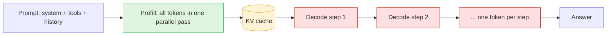

LLMs are the fastest way I know to get from an idea to a demo a customer will pay for. You write a prompt, wire up a few tools, and in a week you have an agent that reads invoices, triages tickets or books appointments. The demo wins the deal, and you ship an MVP.

Then usage grows, and the CFO calls. The bill went from a rounding error to one of the largest lines in the cloud budget, and nobody can say which part of the agent is spending it.

What you pay per token comes down to how the model reads your prompt and writes its answer. Once you see that, the biggest fix follows, and it doesn't change the model. Prompt caching cuts the example agent below by 85%. This is the first of three posts. The next one moves simple, fixed steps to cheaper models, and the one after uses Code Mode to cut the tokens a complex agent sends.

## Where the money goes in an agent

Take a typical agent task. A 20,000-token system prompt holds the instructions and tool definitions. The agent runs 30 turns. Each turn adds about 3,000 tokens of tool results and writes about 500 tokens of output.

The API is stateless, so every turn resends the whole conversation. Turn 1 sends 20,000 tokens. Turn 30 sends 107,000. Over the task that adds up to 1.9 million input tokens and only 15,000 output tokens.

On Claude Opus 5.5, at $4 per million input tokens and $20 per million output tokens ([pricing](https://platform.claude.com/docs/en/build-with-claude/prompt-caching#pricing)), one task costs $7.92. Input is 96% of that. Run 10,000 tasks a day and you spend $79,200 a day, about $2.4 million a month.

Output tokens cost five times more each, but the agent reads far more than it writes. That resent history can be nearly free, and the reason is how the model reads a prompt.

## How a model answers: prefill and decode

To build a GPT yourself and see this in code, watch Andrej Karpathy's [Neural Networks: Zero to Hero](https://www.youtube.com/playlist?list=PLAqhIrjkxbuWI23v9cThsA9GvCAUhRvKZ) playlist. It includes the loop that writes text one token at a time.

Every request runs in two phases.

**Prefill.** The model reads your whole prompt in one pass. Every token goes through every layer at the same time, as large matrix multiplications. GPUs are built for this work, so prefill runs fast per token. As it reads, the model saves a block of numbers for every token, its notes on what that token means in context. These are called keys and values, and together they make up the KV cache. Prefill decides how long you wait before the first word of the answer appears.

**Decode.** The model writes the answer one token at a time. For each token it reads all of the model's learned numbers (its weights) and the whole KV cache out of GPU memory, does a little math, and adds one token. Then it does it again. Each step depends on the one before, so decode can't run in parallel. The GPU spends most of each step waiting on memory, not doing math. This is why output tokens cost several times more than input tokens.

The two phases differ so much that some serving systems run them on separate GPUs ([DistServe, OSDI 2024](https://arxiv.org/abs/2401.09670)).

The KV cache depends only on the tokens the model read. If two requests start with the same 100,000 tokens, prefill computes the same tensors for both.

## Prompt caching means skipping prefill

Prompt caching keeps the KV cache from one request and reuses it for the next request that starts with the same tokens. OpenAI's [caching guide](https://developers.openai.com/api/docs/guides/prompt-caching) says the cache "stores key-value (KV) tensors, not the tokens themselves." On a cache hit the provider loads tensors it already has instead of running prefill again.

The provider skips the pass over your prompt. Reading is cheap per token, but with 100,000 tokens of history that pass is most of the work in the request, so the provider charges you a fraction of the input price. A cache hit also starts answering sooner. When Anthropic launched caching, a 100,000-token prompt went from 11.5 seconds to first token down to 2.4 seconds ([announcement](https://claude.com/blog/prompt-caching)).

In the agent above, everything except each turn's new 3,000 tokens matches the previous request. That is 1.8 million of the 1.9 million input tokens. They don't need prefill again.

### What cached input costs

Three providers shipped caching within ten weeks of each other in 2024. DeepSeek offered "up to 90%" off in August ([news](https://api-docs.deepseek.com/news/news0802)), and Anthropic charged 10% of the input price the same month ([announcement](https://claude.com/blog/prompt-caching)). OpenAI started in October at 50% off ([announcement](https://community.openai.com/t/prompt-caching-automatic/963981)). Two years later all three charge less.

| Model                                                                                                     | Input $/MTok | Cached input $/MTok | Discount |
| --------------------------------------------------------------------------------------------------------- | ------------ | ------------------- | -------- |
| Claude Opus 5.5 ([pricing](https://platform.claude.com/docs/en/build-with-claude/prompt-caching#pricing)) | $4.00        | $0.20               | 95%      |
| OpenAI gpt-6.1-sol ([pricing](https://developers.openai.com/api/docs/pricing))                            | $2.00        | $0.10               | 95%      |
| DeepSeek deepseek-flash, off-peak ([pricing](https://api-docs.deepseek.com/quick_start/pricing))          | $0.15        | $0.003              | 98%      |

Anthropic's standard rule is still 10% of the input price. Opus 5.5 and Sonnet 5.5 are the exception at 5%. OpenAI's guide now says cached input is "discounted up to 95%", depending on the model.

### How long the cache lives

Lifetime decides whether a user who pauses for ten minutes comes back to a warm cache or pays for full prefill on 100,000 tokens. Providers differ more on this than on price.

- Anthropic keeps a cache for 5 minutes and resets the timer free on each hit. A 1-hour cache costs twice the input price to write ([docs](https://platform.claude.com/docs/en/build-with-claude/prompt-caching)).
- OpenAI's GPT-5.6 and later default to 30 minutes, with a 12-hour option at a higher write price ([guide](https://developers.openai.com/api/docs/guides/prompt-caching)).
- DeepSeek has no setting. Its API docs say unused cache is cleared "usually within a few hours to a few days" ([guide](https://api-docs.deepseek.com/guides/kv_cache)). DeepSeek's infrastructure notes list "retain KV cache for more than 72 hours" as a design goal. They keep agent traffic for 3 days and chatbot traffic for 7, on "roughly 100 PiB of SSD storage for the KV cache" ([DeepInfer deployment Q&A](https://github.com/deepseek-ai/DeepInfer/blob/main/doc/inference_deployment_qa.md)). That is an internal target, not something the API promises.

DeepSeek can charge 98% less for a cache hit and keep it for days because storing keys and values on SSD costs less than running prefill again.

### What caching does to the bill

Here is the same agent task on Opus 5.5 with caching. Anthropic charges 25% over the input price the first time it stores tokens in the cache. So each turn writes its new 3,000 tokens to the 5-minute cache at $5 per million and reads everything before it at $0.20. Output is unchanged.

|              | Per task | 10,000 tasks a day, for 30 days |
| ------------ | -------- | ------------------------------- |
| No caching   | $7.92    | $2,376,000                      |
| With caching | $1.19    | $358,380                        |

That is 85% off without changing the model, the prompt or the output.

### Why your cache misses

A request only hits the cache if it starts with exactly the same bytes as an earlier one. Change one byte and everything after it misses. These are the usual causes.

- A timestamp, request ID or user name near the top of the system prompt. Move anything that changes per request to the end.
- Tool definitions that come out in a different order each time, for example built from an unordered map or from JSON with unsorted keys. Sort them.
- Editing or summarizing earlier turns. Append new turns to the history instead of rewriting it.
- Switching models partway through a conversation. Each model has its own cache.
- A prompt shorter than the minimum. OpenAI won't cache under 1,024 tokens on GPT-5.6 and later.

Don't guess whether caching works. Every provider reports it on each response. Anthropic returns `cache_read_input_tokens`, OpenAI returns `cached_tokens`, and DeepSeek returns `prompt_cache_hit_tokens`. Log the field and alert when it drops to zero.

## Where to start

1. Measure first. Log input, cached and output tokens for each agent step, and find the steps that spend the most.
2. Turn on caching and fix the prefix. Freeze the system prompt and tool list, append history instead of editing it, and watch the cache-hit field. For a long-running agent this alone cut the example bill by 85%.
3. Pick a cache lifetime that matches how long users pause between turns.

The first two need no new vendor and don't change what the agent does. Start there.
